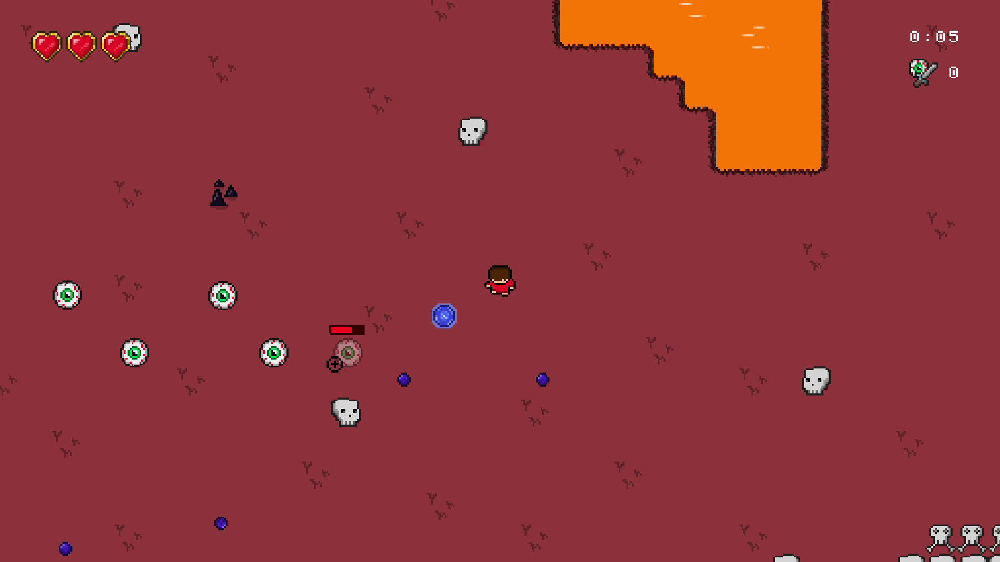
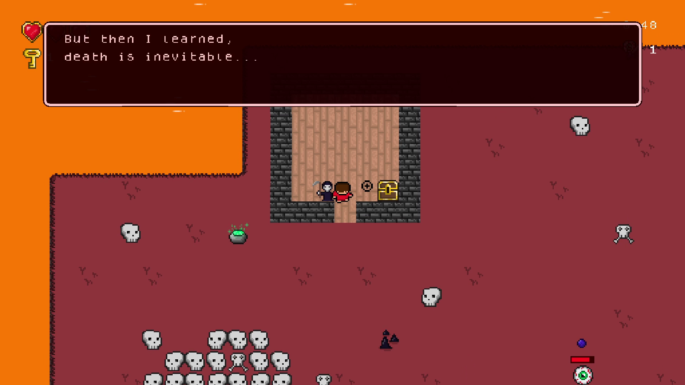
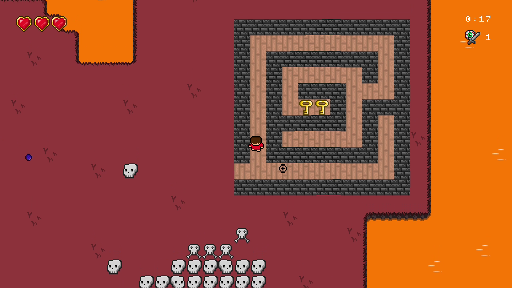
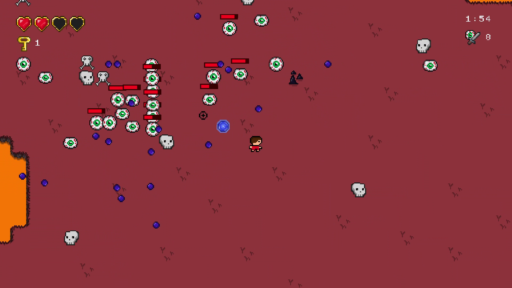
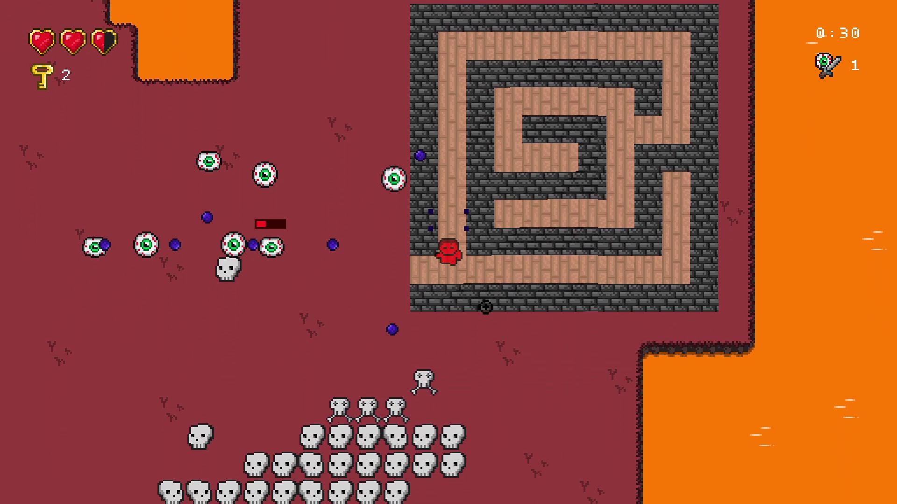

## Screenshots

## Technical highlights
- **No game engine:** built from scratch in Java (rendering, input, audio, game state)
- **A\* pathfinding:** monsters find a route to the player around obstacles
- **Fixed-timestep game loop:** game logic runs at the same speed on every machine
- **Tile-based maps:** levels are built from tile maps, with collision against solid tiles

# How to run the game?

1. Run Java (main)
2. By using W and S keys, choose the "New Game" option.
3. Press Enter to start the game.

# Features to test

# 1. Options Menu
1. By pressing ESC key, options menu will appear.
2. Moving with W and S keys, you can navigate in the options menu.
3. To change the volume of the music or sound effects, use A and D keys.
4. To close the options menu, navigate to "Back" option and press Enter.

# 2. Opening Doors
5. Move the character with WASD keys and get two keys on the right side of the map.
6. With the 2 keys, open two doors: one at the bottom of the map and one at the top.
7. After opening doors, go next to the chest inside. Each chest will add +1 heart to your max life.

# 3. NPC
8. Inside one of the buidlings, there is a Reaper NPC. Go near to see what he has to say.
9. Press ENTER  to close NPC dialogue screen.

# 4. Fight Monsters
10. Time played is shown on top right. As time increases, more monsters will spawn randomly.
11. For short-range combat, press E to attack with a sword. (only when not moving)
12. For lnog-range combat, use the Left Mouse Click to throw a projectile.
13. Number of monsters killed is also shown on top right.

# 5. Heal
14. The player will heal half-heart every 5 seconds.
15. If you need extra healing, go the cauldron next to Reaper NPC.
16. The cauldron can heal you up to 1.5 hearts but has a 10s cooldown.
17. Survive as long as possible and kill as many monsters as possible.

